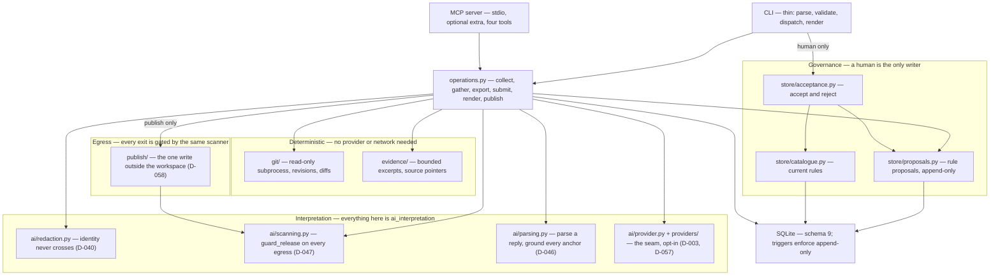
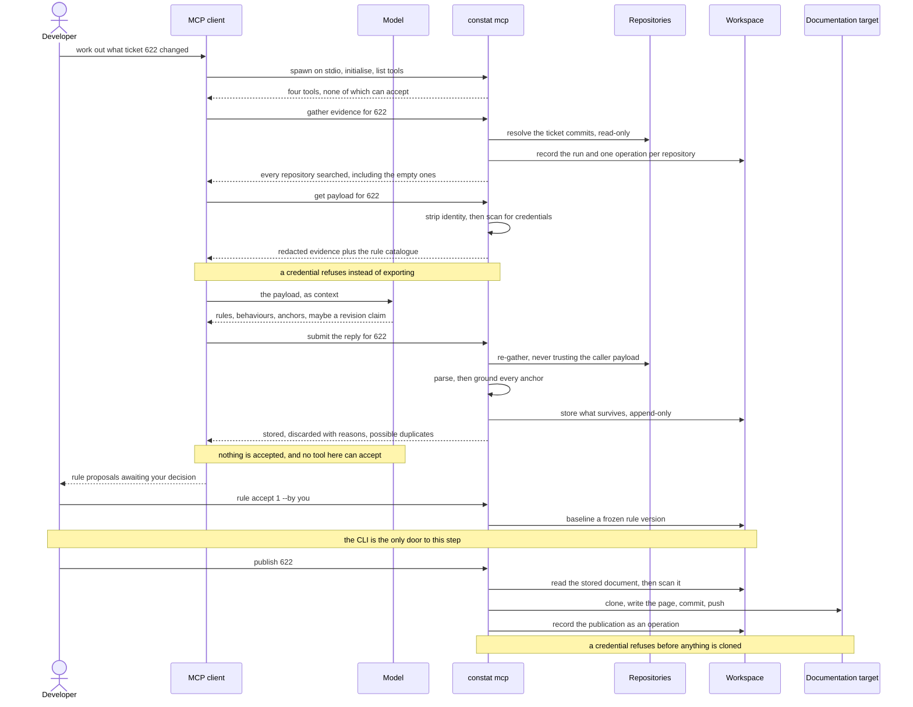
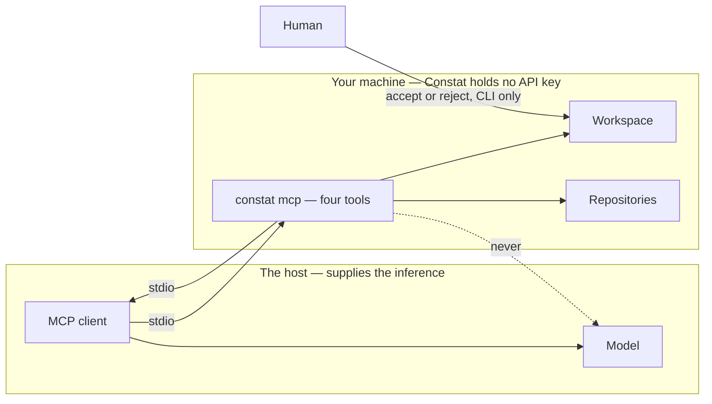

# Constat — Architecture

Version 0.2 · 2026-11-12 · **implemented through CON-50**; §§ 2–4 describe the code as it is

This document describes the *smallest* architecture that supports the MVP in
[PRODUCT_SPEC.md](PRODUCT_SPEC.md) § 6, and the shape to grow into afterwards. Keep the first
version deliberately boring: the goal is to validate the product workflow, not to demonstrate
infrastructure sophistication.

---

## 1. Technology choices

| Area | Start with | Why |
| --- | --- | --- |
| Language / interface | Python CLI | Fast to build, easy to test, suitable for Git analysis and structured data. |
| Git access | `git` command line via `subprocess` | Uses Git's mature capabilities; avoid implementing Git internals. |
| Data validation | Pydantic | Enforces a stable schema for evidence and proposals. |
| Persistence | SQLite | Simple local persistence without running a database service. |
| Reports | Markdown | Readable, portable, easy to commit to a repository. |
| Tests | pytest | Protects the evidence, approval and versioning rules. |
| AI | Provider interface; optional, later | Keep deterministic evidence collection separate from AI interpretation. Avoid recurring API costs in the first prototype. |

**Deferred:** web dashboard, multi-tenant SaaS, authentication, billing, Kubernetes, Kafka, graph
database, multi-agent workflows, automatic approval.

## 2. Layers

The central constraint: **deterministic evidence collection is independent of AI interpretation**,
and **nothing becomes official without a human decision**. The layering exists to make those two
rules structurally enforced rather than merely intended.



Read the arrows as "may depend on". Two absences are the point: nothing in `DET` points into
`INT`, and nothing in `INT` points into `GOV`.

### Dependency rule

Each layer may depend only on layers above it in that list. In particular:

- The Git adapter and evidence engine **never** import the interpretation layer. The evidence path
  works with no AI provider configured, and no network (D-003, D-041).
- The interpretation layer **never** writes a rule. Only `Review`, driven by a human at the CLI,
  produces a rule version (D-048, D-053).
- **`ai/parsing.py` takes `(text, payload)` and nothing else.** It has no idea whether the text came
  from an HTTP response or an agent in the same terminal, which is what made D-045's change of
  direction cheap.
- **No MCP tool reimplements an operation.** Every one calls the same function the CLI does, so the
  gates hold there by construction rather than by being re-applied (D-055).
- Rendering is a pure function of stored structure. It must never discover new facts.

## 2.1 The workflow, driven from an AI implementation

This is the intended path (D-045). On it the **host supplies the model**, so Constat calls nothing
and needs no API key: it runs as a subprocess the client spawns over stdio, and nothing listens on
a port. Constat *can* call a model itself when `CONSTAT_AI_PROVIDER` is set (D-057), which is the
other path and not this one.



### Where the model lives, and where the wall is



Two properties that diagram is drawing:

- **On the MCP path, Constat never calls a model.** The dotted line is the arrow that does not
  exist: the host already has the inference, so Constat holding a key as well would mean two
  billing relationships for one reading. `constat mcp` needs no API key, ever (D-003, D-045).
- **Acceptance has one door and a model is not behind it.** There is no `accept` tool, and a test
  asserts the live tool list to keep it that way (D-055).
- **The loop starts from the agent.** `gather_evidence` opens a ticket it does not find, so no
  command-line step precedes the agent's first call (D-063). The tool list is unchanged by that —
  which is the argument for it: a precondition was removed, not a capability added.

**The other path does call a model, and it is opt-in.** `CONSTAT_AI_PROVIDER=anthropic` makes
Constat issue the request itself, which is what gives `ticket add` a review queue with no MCP
client and no `rule submit` (D-057). It changes nothing about the wall: the payload is the same
redacted, credential-scanned payload, and acceptance is still only reachable from the CLI. Three
things stay true whichever path is used — identity never crosses (D-040), egress goes through
`guard_release` (D-047), and with no provider configured the evidence pipeline runs in full.

**There are three egress points, and one scanner.** `document --payload`, the MCP `get_payload`,
and `constat publish` all leave the machine, and all three go through the detectors in
`ai/scanning.py` — `guard_release` for a payload, `guard_publication` for a rendered document.
Publishing is the one that cannot be recalled: a payload reaches a provider under contract, while a
page can reach everyone with access to the wiki, and deleting it afterwards does not unpublish it.
That is why it refuses by default and why the override is recorded (D-058).

### The same loop without an agent

Two ways, and the difference is only who calls the model. **With a provider configured, there is no
submit step** — that is what CON-60 was for:

```
export CONSTAT_AI_PROVIDER=anthropic            # and ANTHROPIC_API_KEY
constat ticket add 622                          # gathers, reads, fills the queue
constat rule proposals 622                      # the review queue
constat rule accept 1 --by you                  # a human decides
constat publish 622                             # where the business audience reads it
```

**Without one**, the same loop runs with the reading done by hand. Every tool is a CLI command, so
this works end to end — and it is how the pipeline is tested, because it needs no key:

```
constat document 622 --payload > payload.json   # evidence out, through the gate
#   …any model, anywhere, reads it…
constat rule submit 622 --from reply.json       # grounded, stored, discards reported
```

Everything after that point is identical. `submit` is not a workaround for a missing feature: it is
the same door the MCP server uses (D-045), which is why the manual path cannot rot.

### The refusals, each with a test

| Where | Refuses | Why |
| --- | --- | --- |
| Export | A payload carrying a credential | By the time it has printed, it has left (D-047) |
| Export | Author and committer identity, always | Rule generation needs *what* changed, never *who* (D-040) |
| Submit | A reading whose anchors are not in the evidence | Otherwise the tool invents its own evidence (D-046) |
| Submit | A reply that cannot be parsed | Returning nothing would read as "no rules were identified" (D-046) |
| Provider | A call that did not complete | A timeout is not a finding about the code (D-041, D-057) |
| Publish | A document carrying a credential | A page cannot be recalled; it refuses before cloning (D-058) |
| Publish | A target that had to be guessed | A push to a guessed URL is not undone by noticing (D-058) |
| Gather | Opening a ticket for a reference no repository knows | A typo would become a ticket that cannot be opened again (D-063) |
| Everywhere | Any non-human acceptance | No tool, CLI or MCP, can accept (D-048, D-055) |

## 3. Proposed package layout

As built. Compare with the git history rather than this list if they ever disagree.

```
constat/
  cli.py              # entry point; thin by design
  config.py           # input validation — shape only (D-016)
  errors.py           # one type per failure kind; exit codes 2–6
  models.py           # Pydantic: the published shapes, incl. RuleProposal
  globs.py            # one anchor matcher, shared by grounding and the catalogue
  operations.py       # collect, gather, export_payload, submit_reply, render, publish
  mcp.py              # the MCP server (optional extra)
  git/
    adapter.py        # read-only discovery and revision resolution (D-019, D-020)
    diff.py           # merge-base comparison, renames, deletions (D-021, D-022)
  evidence/
    collector.py      # bounded excerpts, fair-share allocation (D-023, D-024)
  ai/
    redaction.py      # the privacy boundary (D-040)
    scanning.py       # credential detection and guard_release (D-044, D-047)
    parsing.py        # reply -> grounded rule proposals (D-046)
    provider.py       # Provider protocol, NullProvider (D-003, D-039)
    settings.py       # provider resolution from the environment only (D-041)
    providers/
      anthropic.py    # the one real provider, optional extra (D-057)
  publish/
    port.py           # the Target protocol and PublishedRef (D-058)
    targets/
      git_pages.py    # the default target: a git-backed docs repository
  store/
    schema.py         # schema 9 + migrations + append-only triggers
    settings.py       # workspace settings; the one table not append-only (D-060)
    workspace.py      # connection, versioning, transactions
    registry.py       # registered repositories (D-025, D-027, D-028)
    tickets.py        # tickets and their one document (D-029, D-032)
    catalogue.py      # current rules, matching, coverage
    proposals.py      # rule proposals and decisions, append-only (D-051)
    acceptance.py     # Review: accept / reject / history (D-053)
tests/                # 697 tests; conftest.py + helpers.py build throwaway repos
```

Not built: comments (CON-39, CON-47, CON-48), the Markdown report (CON-09), GitHub metadata and
PR linkage (CON-16, CON-17), remote clone-and-cache (CON-35).

## 4. Data model sketch

Subject to Session 07; recorded here so the shape is reviewable now.

- **Repository** — local path, resolved Git root, optional GitHub remote identity.
- **RevisionRange** — base revision, target revision, both resolved to full commit SHAs plus the
  symbolic name the user typed.
- **Commit** — SHA, author, committer, dates, message, parent SHAs (so merges are explicit).
- **FileChange** — path, previous path (renames), change type, line counts.
- **EvidenceItem** — provenance type, bounded excerpt, and a **source pointer** (`rev:path:lines`)
  that lets a reviewer re-derive the full original from Git.
- **Claim** — a single statement, its provenance type, and the evidence items supporting it. A claim
  with no supporting evidence must render as visibly uncertain.
- **ChangeProposal** — `schema_version`, stable identifier, repository, revision range, claims,
  classification, open questions for the reviewer, status (`proposed` / `approved` / `rejected`).
- **Decision** — reviewer identity (asserted, not authenticated), timestamp, action, rationale, the
  proposal content as decided.
- **Baseline** — append-only version row: proposal content at approval time, source revisions,
  content hash, previous baseline version. Never updated in place.

## 5. Integrity rules the tests must protect

These are the "key historical-integrity rules" in acceptance criterion 7. They are listed here so a
test exists for each.

1. Approving a proposal creates a **new** baseline version; no existing baseline row is modified or
   deleted.
2. Earlier baseline content remains byte-recoverable after any number of later approvals.
3. A rejection is persisted with its rationale and remains traceable; it does not vanish.
4. No proposal reaches `approved` without a recorded human decision.
5. Every claim in a stored proposal has exactly one provenance type.
6. With no AI provider configured, the pipeline still produces a valid report containing zero
   `ai_interpretation` claims.
7. Evidence source pointers resolve back to real Git objects.
8. Parallel release streams do not collapse: baselines are keyed such that two branches can each
   have their own approved history.
9. A provider failure never reaches the document as a finding: a call that does not complete raises
   rather than returning an interpretation with no proposals (D-041, D-057).
10. A self-reported model id is never displayed as an established one. Only a reading Constat
    issued itself is shown without the caveat (D-057).
11. Every stored decision names a decider, and records whether that name was stated by a person or
    inferred from git's configured identity (D-061).

## 6. Security posture

- **Read-only against every repository Constat reads.** No writes, no commits, no pushes and no PR
  comments to a subject repository, ever. Gathering evidence cannot change what it is evidence of.
- **One write path exists, and it is opt-in:** publishing a document to a documentation target
  (D-058). It writes a Markdown page to a target named explicitly or derived from the repository's
  remote, and nothing else. It never touches the subject repository's branches or history, and it
  is reached only by `constat publish`, never by `gather`.
- Credentials come from the environment or an OS keychain — **never** from files in this repository.
  GitHub access starts with least-privilege, read-only scope on **one** repository.
- `.gitignore` must cover the local database, reports and any `.env`.
- No customer code, production secrets or personal data is sent to any tool or AI provider without
  checking applicable policies and permissions first.

## 7. After the MVP

Expand only when a pilot exposes a concrete need. The sensible future shape:

- **Connectors** — Git repositories, pull requests, issues, CI/test results, API specifications,
  schema registries.
- **Evidence and change engine** — deterministic extraction and normalisation, independent of the AI
  provider.
- **Product knowledge model** — capabilities, services, repositories, releases, change groups,
  traceability links.
- **Interpretation layer** — AI proposes impact and plain-language explanations, always tied to
  evidence and uncertainty.
- **Governance** — human review, approvals, rejection rationale, immutable baselines, audit history.
- **Interfaces** — CLI first; then GitHub integration, an API and possibly MCP; a dashboard only when
  users need one.
- **Deployment** — local-first for the prototype; evaluate hosted or self-hosted based on customer
  security needs.

### Expansion order

1. **Next:** GitHub App or GitHub Action, PR ingestion, multiple repositories, explicit change
   grouping.
2. **Then:** product capability model, service/API/event/schema relationships, release streams,
   richer traceability.
3. **Then:** team review workflows, roles, audit export, self-hosted deployment, organisation-level
   policies.
4. **Later:** hosted dashboard, integrations, advanced analytics, commercial plans, AI-provider
   options.
