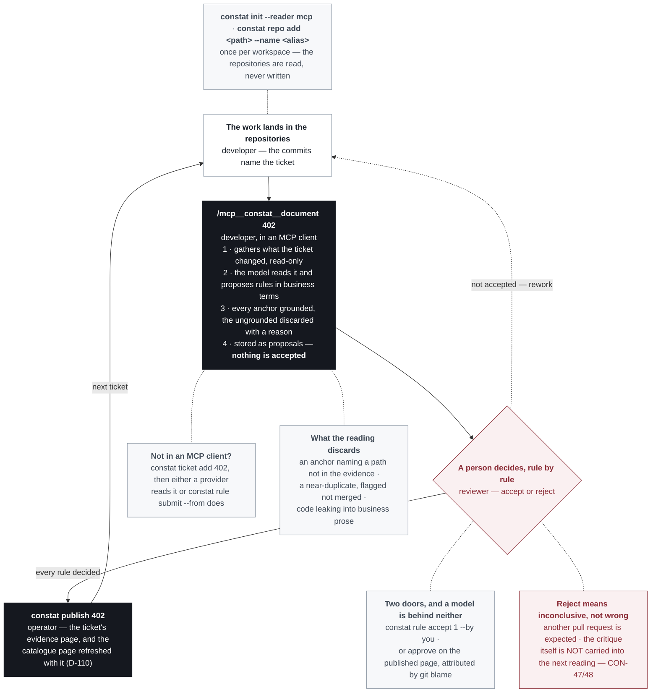

# The command loop, end to end

Version 0.2 · 2026-11-21 · the commands as they exist today

This is the operational view: **what you actually type, who types it, and what happens when it
refuses.** Only commands a person runs appear below — the MCP tools an agent calls in between are
an implementation detail of one step, and live in [ARCHITECTURE.md](ARCHITECTURE.md) § 2.1 with the
rest of the component view. [USAGE.md](USAGE.md) is the same loop with real terminal output.

Where something is designed but unbuilt, it is marked rather than drawn as though it worked —
product rule 1 applies to this document too.

---

## The loop

Three steps and a decision. Everything else Constat can do is a question you ask of it, not a stage
the work passes through — those are in [Any time](#any-time) below.

---

## Who does what

Constat has no role model in the code: any of these may be the same person, and nothing is enforced
by permissions. The distinction that **is** enforced is narrower and more important — a model may
propose, and a person must decide.

| Role | Does | Where |
| --- | --- | --- |
| **Developer** | writes the code, names the ticket in the commits, runs the reading | the repositories, then an MCP client |
| **Reviewer** | decides, rule by rule | a terminal, or the published page |
| **Operator** | sets the workspace up, publishes | a terminal |

## The reading, three ways

One step, three ways to drive it. The gates are identical on all three, because no path
reimplements an operation.

| | What you type | What it needs |
| --- | --- | --- |
| **MCP** | `/mcp__constat__document 402` | an MCP client. The host supplies the model, so Constat holds no API key and the ticket is opened for you |
| **Provider** | `constat ticket add 402` | `CONSTAT_AI_PROVIDER` and an API key, billed separately. The reference must be one a repository recognises, or `--even-if-absent` |
| **By hand** | `constat ticket add 402`, then `constat rule submit 402 --from reading.json` | nothing — any model, anywhere, or no model at all |

With no provider configured the evidence path still runs in full. The two commands whose purpose
*is* to produce rules — `document` and `ticket add` — refuse with exit 5 rather than reporting that
no rules were identified.

## At the decision: two doors

| Channel | Attribution | Verification | What backs the decider's name |
| --- | --- | --- | --- |
| `cli` | `stated` | `asserted` | a `--by` string nothing checks |
| `cli` | `inferred` | `asserted` | git config on the machine that ran the command |
| `git_pages` | `commit` | `git_commit` | a commit author, attested by the repository's history |
| `git_pages` | `commit` | `signed_unverified` | the above, and a signature nobody here could check |
| `git_pages` | `commit` | `signed_commit` | git checked the signature and was satisfied |

An approval made by someone who never opens a terminal is therefore **better evidenced** than one
made at the command line. The second door is reached by committing a verdict beside the published
document and running `constat publish 402 --record-decisions`; `--read-decisions` shows what
Constat read without recording anything.

**There is no `accept` tool on any MCP surface**, and a test asserts the *live* tool list to keep it
that way. A tick on the published page is inert on purpose — a checkbox carries no author.

To tag an acceptance with a release, the name has to exist first:
`constat release declare 2026.11` then `constat rule accept 1 --by you --release 2026.11`. A
release is a label stored exactly as given and never interpreted — it decides nothing about current
behaviour, which is verified against mainline instead.

## When it refuses

The loop is built so that something Constat cannot support never quietly becomes a claim.

- **A reference matching no commits in any repository** is refused rather than opened. A typo does
  not become a ticket.
- **A credential in the evidence** refuses the export; **a credential in the document** refuses the
  publish. The same scanner guards every exit.
- **An anchor naming a path absent from the evidence** is discarded with its reason. This is the
  commonest refusal and the whole point: a rule may not invent its own evidence.
- **A near-duplicate of a rule already in the catalogue** is flagged, never silently merged.
- **An unreadable repository** is reported, not skipped, because its files are missing from the
  grounding map and silence would make a rule look wrong rather than unread.

Exit codes are in [USAGE.md](USAGE.md) § 8. The two that mean "partly done" are `7` — accepted, but
the ticket's branch did not land — and `8` — the target was read, but at least one decision could
not be recorded.

## Any time

None of these are stages in the loop. They are questions you ask of the catalogue.

| Command | Answers |
| --- | --- |
| `constat state` | what the product does now, and what is agreed but not yet shipped |
| `constat publish` | the same picture, as a page where the people who decide can read it |
| `constat rule proposals` | everything awaiting a decision, across every ticket |
| `constat rule show R-1` | one rule as the catalogue holds it |
| `constat rule history R-1` | every accepted version of one rule, by citation or name |
| `constat message verify` | the user-facing messages, checked against the code |
| `constat baseline <area> --as <REF>` | documents an area no ticket changed. You read the repository; Constat grounds the anchors against mainline |
| `constat ticket requirement` | records what a person says the work answers — supplied, never fetched |
| `constat checkpoint take` / `checkpoint changes` | freezes the catalogue, and says what has moved since |
| `constat release declare` / `release show` | names a set of agreed versions, and reports what was agreed for it |
| `constat area list` | the declared areas, so two readings do not invent two names for one thing |

## Designed, not built

Named here so the diagram above is not read as a finished machine.

| What | Ticket | Consequence today |
| --- | --- | --- |
| Comments carry the critique into the next reading | CON-47, CON-48 — blocked on CON-39 | A reviewer who disagrees with one sentence must reject the whole reading, and the substance of the objection is lost |
| Closing a release puts its versions into effect | CON-86 | A release is a label on an acceptance. It decides nothing about current behaviour, which is verified against mainline |
| Release lines in parallel | CON-99 | Shipping is answered against one mainline per repository |

## What the demo covers

`demo.sh` runs this loop end to end with no API key and no network, against a throwaway repository.
It covers setup, the reading by hand, the queue, the decision, `state`, a second reading that
revises the rule, checkpoints, and three refusals. **It does not run `publish`** — that step is
exercised by the test suite against a bare repository, not by the demo.

---

Git is the evidence, and Constat only reads it. The one exception is merge-on-accept — off by
default, performed in a temporary clone, refusing on any ambiguity. No credential is stored, and
the documentation target is reached with plain `git`, so the loop runs on any git host and needs no
forge API.
